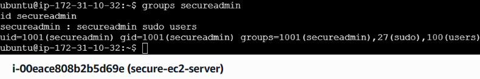
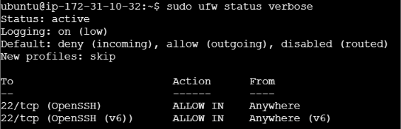
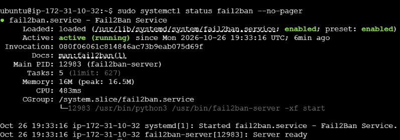
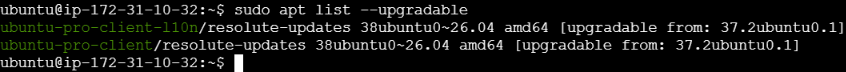
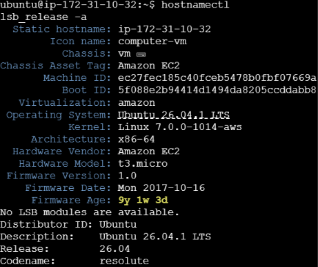

# 🔐 Secure EC2 Server Hardening | AWS Cloud Security

A hands-on cloud security project focused on securing an Ubuntu Server hosted on Amazon EC2 using Linux hardening, firewall configuration, access control, and security monitoring.

## 📌 Project Overview

This project demonstrates the implementation of essential security practices for an Ubuntu EC2 instance on AWS.

The objective is to reduce the server's attack surface, restrict unauthorized access, maintain system updates, and establish a foundation for cloud security monitoring.

## 🎯 Objectives

- Deploy an Ubuntu Server on Amazon EC2.
- Configure secure administrative user access.
- Implement host-based firewall rules using UFW.
- Restrict remote access using AWS Security Groups.
- Configure Fail2ban for SSH protection where applicable.
- Apply operating system security updates.
- Capture screenshots as evidence of security configuration.
- Document the implementation in a GitHub repository.

## 🛠️ Technologies Used

| Technology | Purpose |
|---|---|
| AWS EC2 | Cloud-based virtual server |
| Ubuntu Server | Linux operating system |
| AWS Security Groups | Network-level traffic filtering |
| UFW | Host-based firewall |
| Fail2ban | Protection against repeated authentication failures |
| SSH / Session Manager | Secure server administration |
| Git | Version control |
| GitHub | Project documentation and evidence |

## 🏗️ Architecture

```text
              Administrator
                    |
                    v
          AWS Management Console
                    |
                    v
             AWS EC2 Instance
                    |
                    v
           AWS Security Group
                    |
                    v
             Ubuntu Server
                    |
          +---------+---------+
          |         |         |
          v         v         v
         UFW     User Access  Updates
          |
          v
      Traffic Filtering

    Fail2ban and monitoring
    where configured
```

## 📂 Repository Structure

```text
secure-ec2-server-hardening/
├── README.md
└── screenshots/
    ├── 01-secure-admin-user.png
    ├── 02-ufw-firewall-status.png
    ├── 03-fail2ban-service-status.png
    ├── 04-ubuntu-system-updates.png
    └── 05-ubuntu-system-information.png
```

## 🔒 Security Implementation

### 1. Administrative User Management

Created a dedicated administrative user named `secureadmin` and assigned the `sudo` group for authorized administrative operations.

Commands used:

```bash
sudo adduser secureadmin
sudo usermod -aG sudo secureadmin
groups secureadmin
id secureadmin
```

**Security benefit:** Supports separation between the default login account and a dedicated administrative account.

### 2. UFW Firewall Configuration

Configured UFW to deny incoming connections by default and allow outgoing connections.

```bash
sudo ufw default deny incoming
sudo ufw default allow outgoing
sudo ufw status verbose
```

If SSH is used, the SSH rule must be configured before enabling the firewall:

```bash
sudo ufw allow OpenSSH
sudo ufw enable
```

**Security benefit:** Reduces unnecessary inbound network exposure.

Note: The UFW rules and AWS Security Group rules work independently. Both must be configured correctly for the intended access policy.

### 3. Fail2ban Configuration

Installed and started Fail2ban to provide additional protection against repeated authentication failures.

```bash
sudo apt install fail2ban -y
sudo systemctl enable --now fail2ban
sudo systemctl status fail2ban --no-pager
sudo fail2ban-client status
```

**Security benefit:** Can temporarily ban sources associated with repeated failed authentication attempts when the relevant jail is configured and active.

An active Fail2ban service alone does not prove that an SSH jail is enabled or protecting SSH.

### 4. System Updates

Updated package information and installed available package upgrades.

```bash
sudo apt update
sudo apt upgrade -y
sudo apt list --upgradable
```

**Security benefit:** Helps maintain the server with available package fixes and security updates.

### 5. Operating System Verification

Verified the operating system and administrative user configuration.

```bash
hostnamectl
lsb_release -a
whoami
id secureadmin
```

**Security benefit:** Provides basic system identification and verification evidence.

## 📸 Project Screenshots

The following evidence files document the security configuration. Add each screenshot to the `screenshots/` directory in the repository.

### 1. Administrative User



Verifies the administrative user's identity and group membership.

### 2. UFW Firewall



Shows the firewall status, default policies, and configured rules.

### 3. Fail2ban Service



Shows the Fail2ban service status at the time of verification.

### 4. Ubuntu System Updates



Documents the package update status after maintenance.

### 5. Ubuntu System Information



Shows operating system and system identification details.

## 🧪 Security Verification Checklist

- [ ] Verify the administrative user and sudo membership.
- [ ] Confirm the intended UFW rules are active.
- [ ] Confirm AWS Security Group inbound rules are restricted.
- [ ] Verify the intended remote access method works.
- [ ] Confirm Fail2ban is running and inspect its configured jails.
- [ ] Review pending package updates.
- [ ] Verify screenshots match the actual server configuration.
- [ ] Check that no credentials or private keys are committed to GitHub.

## 🚀 Future Improvements

Planned enhancements for the project:

- Configure AWS Systems Manager Session Manager for access without inbound SSH.
- Implement least-privilege IAM roles.
- Enable and review AWS CloudTrail activity logs.
- Configure CloudWatch monitoring and security alerts.
- Enable automatic security updates where appropriate.
- Add a repeatable Linux security audit script.
- Integrate vulnerability assessment and configuration checks.
- Document security testing results and remediation steps.

## 📚 Key Learnings

This project provides practical experience with:

- AWS EC2 administration.
- Linux user and permission management.
- Network security and firewall policies.
- SSH access security.
- Linux package maintenance.
- Basic cloud security monitoring concepts.
- Git version control and GitHub documentation.

## 👨‍💻 Author

**Sumit Jadhav**

Cyber Security Student | Aspiring DevSecOps Engineer

GitHub: (https://github.com/sumit2662)

## ⚠️ Disclaimer

This project is intended for educational and portfolio purposes. The configurations described here demonstrate selected security controls and do not guarantee that a server is completely secure. Production deployments require additional hardening, monitoring, testing, and ongoing maintenance.

---

**Secure the server. Reduce the attack surface. Verify every control.** 🔐
